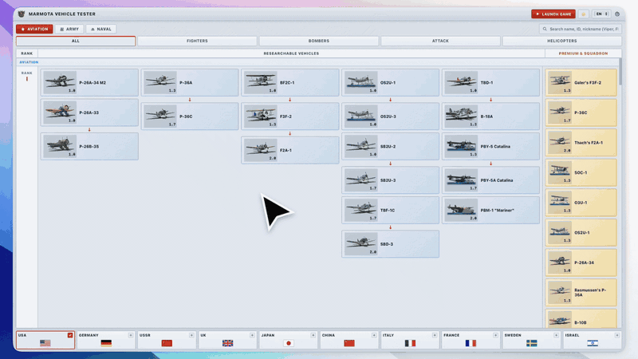
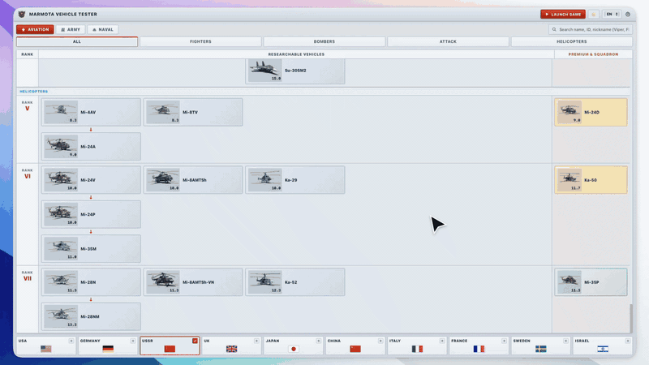
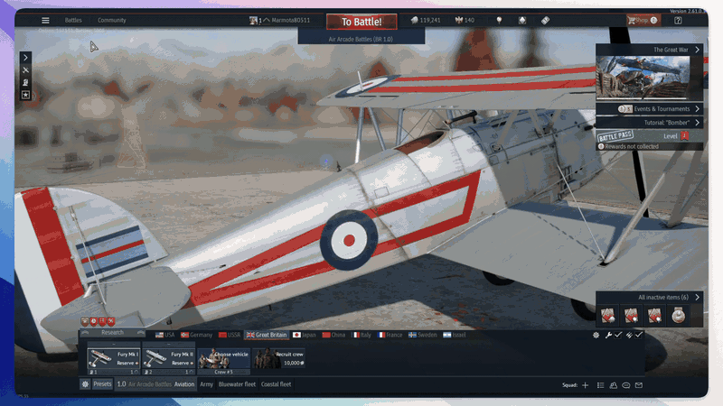

# Marmota Vehicle Tester

> **Offline Tech Tree Inspector, Loadout Matrix Configurator, and Local User Mission Injector for War Thunder.**

Marmota Vehicle Tester is a native, standalone desktop application built with **Rust** (`tao` + `wry` + `axum` + `rusqlite`) that lets you browse the complete War Thunder vehicle catalog offline, inspect and configure pylon-by-pylon weapon loadouts and primary ammunition belts, and inject any vehicle directly into local **User Missions** (`UserMissions/*.blk`) for offline test flights and combat testing.

---

## Key Features

- **100% Offline SQLite Catalog**: Downloads the War Thunder Datamine index once (~47 MB) and builds a local SQLite database for instant search, filtering, and vehicle inspection with no external API dependency at runtime.
- **Full Tech Tree Coverage**: Browse all **10 nations** (USA, Germany, USSR, UK, Japan, China, Italy, France, Sweden, Israel) across **Aviation**, **Army**, **Naval**, and **Helicopters**, including Researchable, Premium, and Squadron vehicles.
- **Interactive Pylon & Loadout Matrix**: Inspect official weapon presets pylon-by-pylon (`P1`–`Pn`) with ordnance icons, guidance types (`IR`, `SARH`, `ARH`, `AGM`, `GBU`, `BOMB`, `RCKT`, `POD`, `FUEL`), and hover tooltips for mass, TNT equivalent, and range/penetration.
- **Primary Belt & Ammo Selector**: Configure primary gun belts/shells and exact ammunition counts before deploying into a mission.
- **1-Click Starter Missions & Local Mission Discovery**: Automatically scans your War Thunder `UserMissions/` directory and lets you import built-in starter test missions (`Aviation Test Flight`, `Ground Vehicle Test`, `Helicopter Test Flight`) with a single click.
- **Automatic War Thunder Path Detection**: Detects Steam, standalone, and custom War Thunder installations on both Windows and macOS, and verifies read/write permissions for `UserMissions` and `content/pkg_local`.
- **7 Interface Languages & Dual Themes**: Instant switching between **English**, **Português (Brasil)**, **Русский**, **Français**, **中文 (简体)**, **日本語**, and **Español**, with **Metallic Light** and **Dark** themes.
- **Zero-Runtime-Bloat Native Binary**: Embedded HTML/CSS/JS frontend, PNG nation flags, and SQLite engine compiled into a single lightweight executable (`.exe` on Windows, `.app` on macOS).

---

## Visual Walkthrough

### 1. Browse Nations, Branches, and Tech Trees
Switch between **Aviation**, **Army**, and **Naval** branches, filter by vehicle class, or search by vehicle name, internal ID, or nickname across all 10 nations.



### 2. Inspect Loadout Matrix & Inject into User Missions
Select any vehicle to view its **Loadout Matrix & Weaponry**, choose a weapon preset and primary ammo belt, select one or more target `.blk` missions, and click **Apply to War Thunder**.



### 3. Launch War Thunder & Test In-Game
Click **Launch Game** (or open War Thunder normally), navigate to **Battles → User Missions**, and launch the configured mission to test the exact vehicle and ordnance setup offline.



---

## System Requirements

### Pre-Built Binaries
- **Windows**:
  - Windows 10 (version 1803+) or Windows 11 (64-bit `x86_64`)
  - **Microsoft Edge WebView2 Runtime** (pre-installed on Windows 11 and most updated Windows 10 systems; available from Microsoft if missing)
- **macOS**:
  - macOS 11 Big Sur or newer (Apple Silicon `arm64` / `aarch64` or Intel via Rosetta)
  - Uses native macOS `WKWebView` (no extra runtime needed)
- **Game**:
  - A local installation of **War Thunder** with write access to `UserMissions/` and `content/pkg_local/`.
  - Internet access is only required once to download the ~47 MB Datamine index (or when updating the catalog).

---

## Installation

### Windows (`.exe`)
1. Download or copy `dist/windows/MarmotaVehicleTester.exe`.
2. Double-click `MarmotaVehicleTester.exe` to run (no installer required).

### macOS (`.app`)
1. Download or copy `dist/macos/Marmota Vehicle Tester.app` to `/Applications` (or run it directly).
2. Because the bundle is ad-hoc signed without an Apple Developer notarization certificate, macOS Gatekeeper may display an *"unidentified developer"* warning on first launch. To open it:
   - **Option A (GUI)**: Right-click (or `Control`-click) `Marmota Vehicle Tester.app` → **Open** → click **Open** in the confirmation dialog.
   - **Option B (Terminal)**: Clear the quarantine attribute:
     ```zsh
     xattr -dr com.apple.quarantine "/Applications/Marmota Vehicle Tester.app"
     ```

---

## How to Use

1. **Initial Setup Wizard**:
   - **Step 1 — Terms & License**: Review and accept the Terms of Use, Privacy Policy, and GNU GPLv3 License.
   - **Step 2 — War Thunder Path & Permissions**: Confirm the auto-detected War Thunder root folder (or click **Browse...** to select it manually) and verify that `UserMissions` and `content/pkg_local` show green read/write status.
   - **Step 3 — Vehicle Catalog**: Click **Download Datamine (~47 MB)** to fetch and index the offline SQLite catalog.
2. **Select a Vehicle**:
   - Use the top branch tabs (**Aviation**, **Army**, **Naval**), class tabs, nation bar at the bottom, or the search box to find any vehicle.
   - Click a vehicle card to open its loadout view.
3. **Configure Weaponry & Missions**:
   - Pick a **Primary Belt / Shell** and set the ammunition **QTY** (or click **MAX**).
   - Click any row in the **Loadout Matrix & Weaponry** table to select a weapon preset.
   - In **Mission Selector**, if you don't have local `.blk` missions yet, click **Import Missions** to copy the 3 built-in starter missions (`aviation_test_flight.blk`, `ground_vehicle_test.blk`, `helicopter_test_flight.blk`) into your War Thunder `UserMissions/` folder.
   - Check one or more target missions and click **Apply to War Thunder**.
4. **Test in War Thunder**:
   - Click **Launch Game** in the top-right corner (or launch War Thunder manually).
   - In the War Thunder hangar, open **Menu → Battles → User Missions** and start the mission you injected.

---

## Building from Source

### Prerequisites
- [Rust](https://rustup.rs/) (`1.80+`, Edition 2021)
- **Windows**: MSVC build tools (`x86_64-pc-windows-msvc`)
- **macOS**: Xcode Command Line Tools (`xcode-select --install`)
- **Linux** (source build): `libwebkit2gtk-4.1-dev`, `libgtk-3-dev`, `libappindicator3-dev`, `librsvg2-dev`

### Run in Development Mode
```bash
cargo run
```

### Run Tests
```bash
cargo test
```

### Build Release Executables
- **Native macOS / Windows**:
  ```bash
  cargo build --release
  ```
- **Cross-compile Windows `.exe` from macOS/Linux** (using [`cargo-xwin`](https://github.com/rust-cross/cargo-xwin)):
  ```bash
  cargo xwin build --release --target x86_64-pc-windows-msvc
  ```

For full packaging instructions (generating `.app` bundles, Windows `.res` metadata, and icons), see [packaging/BUILD_INSTRUCTIONS.md](packaging/BUILD_INSTRUCTIONS.md).

---

## Runtime Directory Matrix

The application automatically adapts its storage paths depending on whether it is running via `cargo run` (development) or as a compiled/packaged executable:

| Platform / Mode | Config (`config.json`) | SQLite Catalog (`catalog.db`) | Datamine Cache & Blobs | Logs (`app.log`) |
| :--- | :--- | :--- | :--- | :--- |
| **Development (`cargo run`)** | `./data/config.json` | `./data/catalog.db` | `./data/cache/` | `./data/logs/app.log` |
| **Windows (`.exe`)** | `%APPDATA%\MarmotaVehicleTester\config.json` | `%LOCALAPPDATA%\MarmotaVehicleTester\catalog.db` | `%LOCALAPPDATA%\MarmotaVehicleTester\cache\` | `%LOCALAPPDATA%\MarmotaVehicleTester\logs\app.log` |
| **macOS (`.app`)** | `~/Library/Application Support/MarmotaVehicleTester/config.json` | `~/Library/Caches/MarmotaVehicleTester/catalog.db` | `~/Library/Caches/MarmotaVehicleTester/cache/` | `~/Library/Logs/MarmotaVehicleTester/app.log` |

---

## Repository Structure

```text
wt_customer/
├── Cargo.toml                  # Rust dependencies and release profile
├── build.rs                    # Windows PE resource compiler (version, manifest, icon)
├── src/                        # Rust backend, Datamine parser, BLK writer, GUI host
├── ui/                         # Embedded frontend (HTML, minified CSS, JS, PNG flags, 7 locales)
├── templates/                  # Built-in starter User Mission .blk templates
├── packaging/                  # macOS Info.plist, Windows manifest, icons, build docs
├── dist/                       # Pre-built Windows (.exe) and macOS (.app) binaries
├── media/                      # Compressed demo GIFs used in this README
├── LICENSE                     # GNU General Public License v3.0
├── NOTICE.md                   # Third-party attributions & War Thunder Datamine credit
├── TERMS_OF_USE.md             # Terms of Use & "AS IS" liability disclaimer
└── PRIVACY.md                  # Offline-first privacy policy
```

---

## Support the Project

**Marmota Vehicle Tester** is 100% free and open-source. If it saves you time or helps you test vehicles and loadouts in War Thunder, consider supporting ongoing development:

- **GitHub Sponsors**: Click the **Sponsor** button at the top of this repository or visit [github.com/sponsors/f05135](https://github.com/sponsors/f05135).
- **Star & Share**: Starring the repository helps other War Thunder players discover the tool.

---

## Legal Notice & License

- **License**: Distributed under the **GNU General Public License v3.0 (GPLv3)**. See [LICENSE](LICENSE) for full terms.
- **Disclaimer ("AS IS")**: This software is provided *"AS IS"*, without warranty of any kind, express or implied. You are solely responsible for local files modified inside your War Thunder `UserMissions/` and `content/pkg_local/` directories. See [TERMS_OF_USE.md](TERMS_OF_USE.md) and [PRIVACY.md](PRIVACY.md).
- **Non-Affiliation**: **Marmota Vehicle Tester** is an independent, community-built open-source tool and is **not affiliated with, endorsed by, or sponsored by Gaijin Entertainment** or War Thunder. Vehicle data and datamine references are sourced from public community datamine repositories (see [NOTICE.md](NOTICE.md)).
